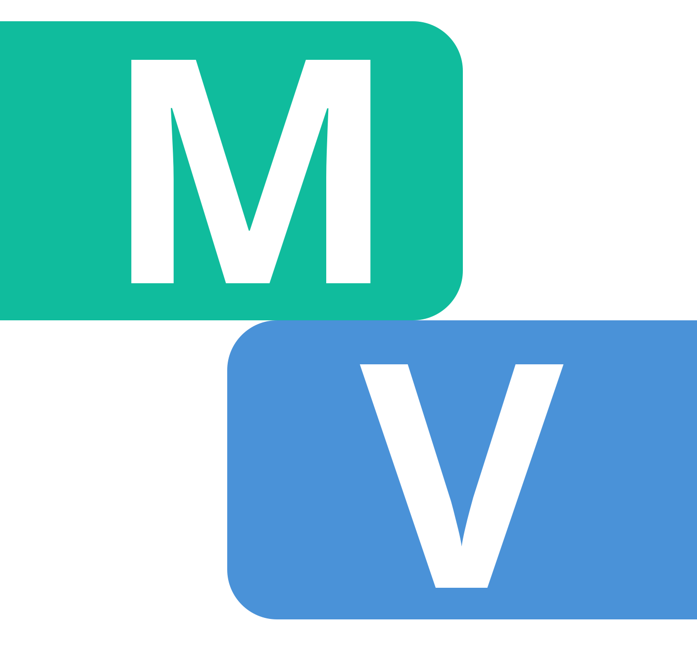

#  Minimalist Program Validator

The Minimalist Validator is an interactive, full-stack computational engine that allows users to practice and generate basic syntax trees, as described by Chomsky's **[Minimalist Program](https://en.wikipedia.org/wiki/Minimalist_program)**.

Drag lexical items from the lexicon into the canvas, construct the syntactic tree from the buttom up, and validate convergence at Logical Form in a simple and intuitive manner.

---

## What's behind the scenes, and how to use the engine?

The engine model syntax trees as DAGs, using a custom linguistic `Node` class.
* **Lexicon**: Drag any lexical item from the lexicon on the left into the canvas. You can also write the specific word/phonology of the lexical item, if it is not null. Each lexical item has its **category** (e.g., `D`, `Adv` or `v`) and a list of its **features**. The features are either interpretable (*$\varphi$-featuers*) or uninterpretable (which are marked with the prefix `u`). In order for the sentence to converge at LF, all uninterpretable features must be **checked**.
* **(External) Merge**: Select two independent nodes by clicking on them, then click the **Merge** button. If one node has an active selectional feature (i.e., an unchecked, uninterpretable category feature) that matches the other node's category (e.g., Merging a `D [uN]` node with a `N` node), the first node (the *head*) will select the second one (the *complement*) and check its own uninterpretable category feature. The two nodes will then acquire a single parent **phrase** node above them, whose features will be mainly percolated from the head node.
* **Adjoin**: Select two independant phrasal nodes (e.g., a `VP` and a `PP`), where one is either a `PP`, an `AP` or an`AdvP` (you can also choose a regular `A` or `Adv` and the engine will automatically project it!), then click the **Adjoin** button. The two nodes will then acquire a new phrasal node whose category and features are percolated from the other node. This operation does not check any uninterpretable features.
* **Agree**: Select a phrasal node whose head (SPEC position) is `T`, `D`, `v` or `P`, then click the **Agree** button. The engine will initiate a DFS over the head's C-command domain (i.e., the complement and its descendants), in Pre-Order traversal, until it finds a valid goal that the head needs. If it finds one, the head will copy the necessary values of the goal, and according to the head's type, assign the goal its grammatical case. This operation checks $\varphi$-features and case features.
* **Internal Merge (Move)**: Select a node inside a certain domain, then click the **Move** button. The node will move out of the tree, merge with the parent of the entire domain (in SPEC position) and leave a trace copy of itself in its original position. This operation does not check any uninterpretable features.
* **Delete/Unmerge & Reset**: Delete a specific node, a full domain, or the wipe the entire canvas clean.
* **Validate Logical Form**: After you create the entire tree, click the **Validate Logical Form** button. The engine will then traverse the entire syntax tree (from buttom up) and verify that every uninterpretable feature is checked. If all features pass the test, the sentence converges at LF.
* **Export JSON & Copy LaTeX**: Export the tree into a JSON dictionary format for future use, or generate LaTeX code of the tree (requires `forest`/TikZ package afterwards).
---

## How to run the engine?

The engine runs on [https://itamarfinkelshtein.github.io/minimalist-validator](https://itamarfinkelshtein.github.io/minimalist-validator). The backend uses Render, which currently spins down with inactivity, so the first operation might take up to a minute to load (after which the operations will be instant).

## Tech Stack

* **Backend**: Python 3, Flask, Flask-CORS, Gunicorn (WSGI server)
* **Frontend**: Vanilla HTML5, CSS3 (Flexbox architecture), Vanilla JavaScript (Drag and Drop API, Fetch API)
* **Serialization & Export**: Recursive JSON tree encoder/decoder preserving specifier/complement branch geometry, alongside a Pre-Order Traversal LaTeX generator that maps visual objects directly to `forest`/TikZ syntax.
* **Deployment**: Render (REST API backend) and GitHub Pages (Frontend static hosting)

## Project Structure

```text
minimalist-validator/
│
├── backend/
│   ├── app.py              # Flask REST API endpoints & tree reconstruction
│   ├── lexicon.py          # Feature and LexicalItem data structures
│   ├── operations.py       # Core generative operations (Merge, Agree, Move)
│   ├── requirements.txt    # Python dependencies including Gunicorn for production
│   ├── tree.py             # Binary Node graph logic & C-command domain computation
│   └── validator.py        # LF convergence inspection algorithm
│
├── frontend/
│   ├── index.html          # Interactive derivation workspace & collapsible lexicon
│   ├── script.js           # DOM manipulation, API callers, JSON/LaTeX exporters
│   └── styles.css          # Flexbox layout, horizontal tree scaffolding, UI styling
│
├── index.html              # Root meta-refresh redirect to frontend/index.html for static hosting
└── README.md
```

---

## Example Derivations

### Transitive Clause with Light $v$ Shell
*Sentence: "John ate apples"*
1. **Merge** `V [uD]` (*eat*) with `DP [3sg]` (*apples*) $\rightarrow$ Forms `VP`.
2. **Merge** `v [uV, uD]` (*+tran*) with `VP` $\rightarrow$ Checks `[uV]`, leaves `[uD]` and forms `vP`.
3. Select `vP` and cilck **Agree** $\rightarrow$ Assigns `ACC` case to `DP` *apples*.
4. **Merge** `DP [3sg]` (*John*) with `vP` $\rightarrow$ Forms full transitive `vP`.
5. **Merge** `T [uφ, uv]` (*+PAST*) with `vP` $\rightarrow$ Forms `TP`.
6. Select `TP` and click **Agree** $\rightarrow$ Assigns `NOM` case to `DP` *John* and its $\varphi$-features, `3sg`, to `T`.
7. Run **Internal Merge** on the subject `DP` *John* $\rightarrow$ Elevates subject to SPEC `TP`, leaving a trace `DP_t`.
8. **Validate LF** $\rightarrow$ Converges ✅


### Recursive Complementizer Embedding
*Sentence: "I know that John ate apples"*
1. Construct embedded `TP` as above.
2. **Merge** `C [uT]` (*that*) with embedded `TP` $\rightarrow$ Forms embedded `CP`.
3. **Merge** matrix `V [uC]` (*know*) with the embedded `CP` $\rightarrow$ Forms matrix `VP`.
4. **Merge** `v [uV, uD]` (*+tran*) with the matrix `VP` $\rightarrow$ Checks `[uV]`, leaves `[uD]` and forms matrix `vP`. (No need to agree).
5. **Merge** `D [uN]` (*$\emptyset$*) with `N [1sg, ucase]` (*I*) $\rightarrow$ Forms  matrix subject `DP`.
6. **Merge** matrix subject `DP` with matrix `vP` $\rightarrow$ forms full transitive vP.
7. **MERGE** `T [uφ, uv]` (*+PRES*) with `vP` $\rightarrow$ Forms `TP`.
8. Select `TP` and click **Agree** $\rightarrow$ Assigns `NOM` case to `DP` *I* and its $\varphi$-features, `1sg` to `T`.
9. Run **Internal Merge** on the subject `DP` *I* $\rightarrow$ Elevates subject to SPEC `TP`, leaving a trace `DP_t`.
10. **Validate LF** $\rightarrow$ Validates matrix clause and embedded clause simultaneously ✅

### Prepositional Adjunction (vP Modification)

*Sentence: "John ate apples in the kitchen"*

1. **Merge** `D [uN]` (*the*) with `N [3sg, ucase]` (*kitchen*) $\rightarrow$ Forms `DP`.
2. **Merge** `P [uD]` (*in*) with `DP` $\rightarrow$ Forms `PP`.
3. Select `PP` anc click **Agree** $\rightarrow$ Assigns `OBL` case to `DP` *the kitchen*.
4. **Merge** `V [uD]` (*eat*) with `DP [3sg]` (*apples*) $\rightarrow$ Forms `VP`.
5. **Merge** `v [uV, uD]` (*+tran*) with `VP` $\rightarrow$ Checks `[uV]`, leaves `[uD]` and forms `vP`.
6. Select `vP` and cilck **Agree** $\rightarrow$ Assigns `ACC` case to `DP` *apples*.
7. Select `vP` and `PP` and click **Adjoin** $\rightarrow$ Creates a two-segment `vP` structure containing the spatial modifier.
8. **Merge** `DP [3sg]` (*John*) with `vP` $\rightarrow$ Forms full transitive `vP`.
9. **Merge** `T [uφ, uv]` (*+PAST*) with `vP` $\rightarrow$ Forms `TP`.
10. Select `TP` and click **Agree** $\rightarrow$ Assigns `NOM` case to `DP` *John* and its $\varphi$-features, `3sg`, to `T`.
11. Run **Internal Merge** on the subject `DP` *John* $\rightarrow$ Elevates subject to SPEC `TP`, leaving a trace `DP_t`.
12. **Validate LF** $\rightarrow$ Converges ✅

---

## What's next?

This engine is still very basic. Some of the next features to be added are:
- [ ] Allowing for different types of `v` (unaccusative, passive, etc.).
- [ ] Adding a <code>C<sub>Q</sub></code> type for questions.
- [ ] Visually illustrate operations such as feature-checking, case assignment and movement.
- [ ] Add a responsive split-screen / mobile layout
- [ ] Apply cyclicity constraints for convegence at LF.
- [ ] Add dynamic numeration options.

## Contact me
 Found a bug/innacuracy? Have a suggestion? Contact me on [Finkelshtein.Itamar@gmail.com](Finkelshtein.Itamar@gmail.com)